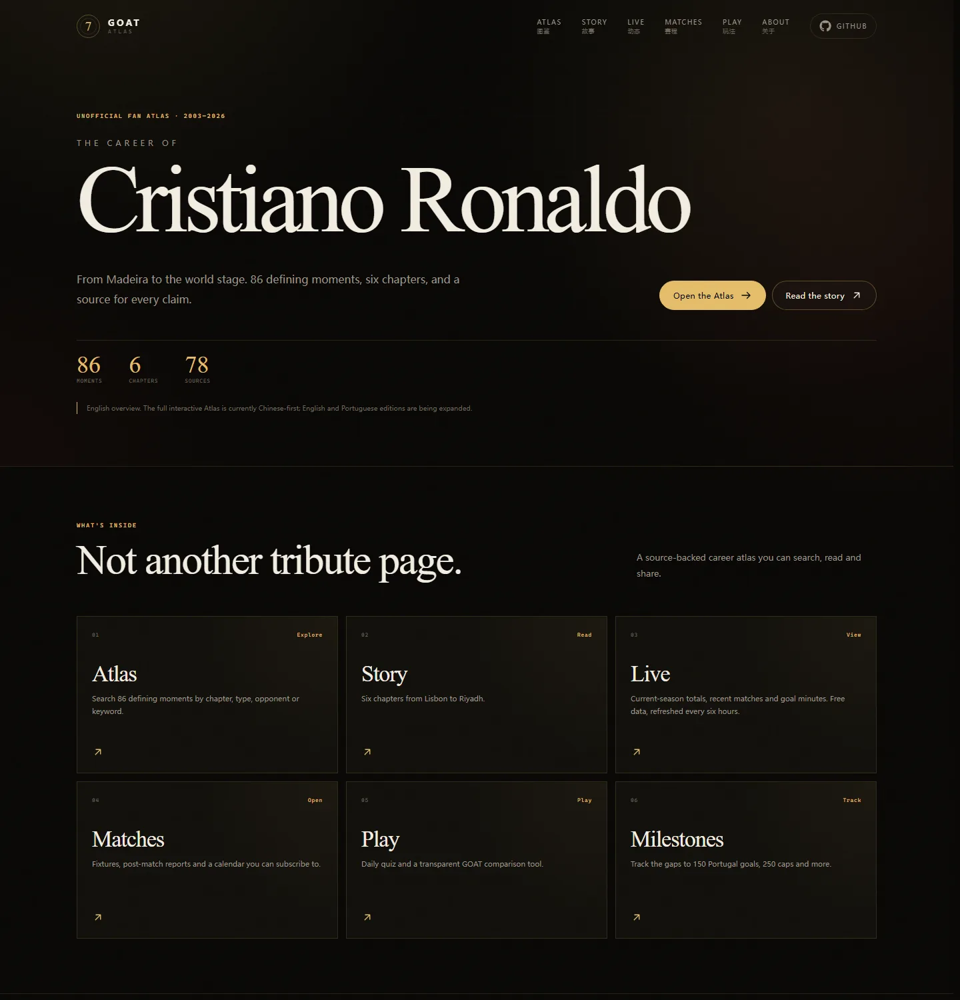

# GOAT Atlas

### 一个可检索、可追溯、可分享的 C 罗职业生涯图鉴

**An open, source-backed career atlas for Cristiano Ronaldo — and eventually every footballer.**

🔗 **Live site:** <https://haohaohao-cell.github.io/goat-atlas/>  
🌐 **English:** <https://haohaohao-cell.github.io/goat-atlas/en/> · **Português:** <https://haohaohao-cell.github.io/goat-atlas/pt/>  
💻 **Repository:** <https://github.com/haohaohao-cell/goat-atlas>

`Next.js 16` · `TypeScript` · `46 moments` · `6 chapters` · `42 sources` · `MIT + CC BY-SA 4.0`




| Atlas 检索 | Story 故事 |
| --- | --- |
|  |  |

| Live 数据 | 分享卡 |
| --- | --- |
|  |  |


| Play 玩法 | GOAT 对比器 |
| --- | --- |
|  |  |


---

## 为什么做这个

球迷不缺集锦，缺的是一张能反复查看、可以验证、还能继续补充的地图。

- **集锦在短视频里**，看完就滑走，找不到上下文。
- **数据在表格里**，很全，但没有故事。
- **故事在评论区里**，很热闹，但常常没有出处。

GOAT Atlas 把名场面、数据、上下文和来源放在同一个页面上。你可以把它当成一部可滚动的传记，也可以把它当成一个可检索的数据库。

C 罗是第一号展馆；数据结构从第一天起就是多球员设计。

## 现在有什么

- **Atlas 检索**：按章节、类型、对手、关键词筛选 46 个名场面
- **Story 故事模式**：六个章节，从里斯本到利雅得
- **详情页**：比分、时间、球场、背景故事、为什么重要、来源链接
- **分享卡**：一键生成 4:5 图片，支持 Web Share / 下载 / 复制链接
- **Live 数据**：最新赛季、最近比赛、C 罗进球分钟、里程碑；免费方案已启用，GitHub Actions 每 6 小时自动同步
- **Match Center**：近期赛程、赛后战报、赛前提醒
- **日历订阅**：`matches.ics` 可导入 Google Calendar / Apple Calendar / Outlook
- **每日问答**：每天 5 题，答题解析、连续天数、结果分享卡
- **GOAT 对比器**：6 个可核实指标，默认权重公开，权重可调
- **历史上的今天**：日期精确匹配才叫 On This Day，没有匹配就展示“今日坐标”
- **里程碑追踪**：职业生涯 1000 球（每 6 小时自动同步，当前 981 = 俱乐部 835 + 国家队 146）、国家队 150 球、250 场、Al-Nassr 联赛 120 球/场等进度
- **多语言入口**：英文 / 葡语 overview（页脚入口，非全站翻译）
- **来源标注**：每条记录至少一个可点击来源
- **PWA**：可添加到主屏幕，带 manifest 和图标
- **响应式**：手机、平板、桌面一套代码
- **静态优先**：所有页面构建时生成，部署成本接近于零

## 为什么是网站，不是 App 或小程序

结论：**Web 是核心，小程序是渠道，App 是后置选项。**

| 形态 | 角色 | 原因 |
| --- | --- | --- |
| Web + PWA | 现在 | SEO、分享、迭代速度、GitHub 用户直接打开 |
| 小程序 | 之后 | 适合国内传播，但需要主体资质、审核，且与开源生态割裂 |
| 原生 App | 最后 | 成本最高，等留存验证后再用 Capacitor / Expo 套壳 |

一套数据层，多个展示壳。不要一开始写三套代码。

## 快速开始

要求：Node.js >= 20.9。

```bash
pnpm install
pnpm dev
```

打开 `http://localhost:3000`。

没有 pnpm 也可以用 npm：

```bash
npm install
npm run dev
```

常用命令：

```bash
pnpm validate    # 校验 data/*.json
pnpm typecheck   # TypeScript 类型检查
pnpm build       # 生产构建（会生成 matches.ics）
pnpm start       # 启动生产服务
pnpm calendar    # 单独生成 public/matches.ics
pnpm sync:live   # 同步 Live 数据（API-Football / Wikipedia 回退）
```

> 构建默认使用 webpack（`next build --webpack`）。原因是 Next 16 + pnpm 在部分 Windows 环境下 Turbopack 解析 `next` 链接会失败；等上游稳定后可以切回 Turbopack。

## 项目结构

```text
app/
  page.tsx                 # 首页
  atlas/page.tsx           # Atlas 检索
  atlas/[slug]/page.tsx    # 名场面详情
  story/page.tsx           # 故事模式
  live/page.tsx            # Live 数据、最近比赛、同步状态
  matches/page.tsx         # 赛程、赛后战报、日历提醒
  play/page.tsx            # 玩法入口
  quiz/page.tsx            # 每日 5 题
  compare/page.tsx         # GOAT 对比器
  today/page.tsx           # 历史上的今天 / 今日坐标
  milestones/page.tsx      # 里程碑进度
  en/page.tsx              # English overview
  pt/page.tsx              # Portuguese overview
  about/page.tsx           # 项目、数据原则、路线图
  manifest.ts              # PWA manifest
  sitemap.ts / robots.ts   # SEO
components/
  AtlasExplorer.tsx        # 搜索 + 筛选（客户端）
  StoryExperience.tsx      # 滚动叙事 + 章节导航
  ShareCard.tsx            # 分享卡导出
  MatchCalendarActions.tsx # 日历下载 / 订阅链接复制
  QuizGame.tsx             # 每日问答、连击、结果卡
  CompareTool.tsx          # 加权对比器
  LocalizedHome.tsx        # 英文 / 葡语 overview
  MomentCard.tsx
  EraCard.tsx
components/Icons.tsx
data/
  player.json              # 球员、俱乐部、章节
  moments.json             # 46 条名场面记录
  live.json                # 最新赛季 / 比赛 / 同步状态
  quiz.json                # 每日问答题库
  compare.json             # GOAT 对比指标
  milestones.json          # 里程碑目标与当前进度
lib/
  data.ts                  # 数据加载、排序、关联
  live.ts                  # Live 数据加载
  quiz.ts                  # 每日出题
  compare.ts               # 对比数据加载
  today.ts                 # 日期匹配 / 今日坐标
  milestones.ts            # 里程碑进度计算
  i18n.ts                  # 英文 / 葡语文案
  schemas.ts               # Zod schema
  types.ts
scripts/
  validate-data.mjs        # CI 数据校验
  sync-live.mjs            # API-Football / Wikipedia → data/live.json
  sync-milestones.mjs      # Wikipedia 生涯统计表 → data/milestones.json
  generate-calendar.mjs    # data/live.json → public/matches.ics
  generate-assets.py       # 生成 OG 图和 PWA 图标（可选）
```

## 数据贡献

最需要的三类贡献：

1. **纠错**：日期、比分、对手、球场、来源有误。
2. **补充来源**：给已有记录加更权威的链接。
3. **新增名场面**：尤其是被现有 46 条忽略的节点。

流程：

```bash
# 1. 修改 data/moments.json
# 2. 跑校验
pnpm validate
# 3. 本地确认页面
pnpm dev
# 4. 提 PR
```

一条记录至少需要：

```json
{
  "slug": "ucl-2008-final",
  "date": "2008-05-21",
  "title": "莫斯科雨夜，首夺欧冠",
  "kind": "trophy",
  "era": "manchester-1",
  "summary": "一句话说清楚发生了什么。",
  "context": "更完整的背景叙述。",
  "why": "为什么这个瞬间值得被记住。",
  "tags": ["trophy", "champions-league"],
  "sources": [
    { "label": "2008 UEFA Champions League final — Wikipedia", "url": "https://..." }
  ]
}
```

质量标准：

- 日期使用 `YYYY-MM-DD`
- 至少一个可点击来源
- 区分**事实**（比分、时间）和**叙事**（为什么重要）
- 不确定的内容标注“待核实”，不要编
- 不搬运未授权的比赛照片或转播画面

详细说明见 [CONTRIBUTING.md](CONTRIBUTING.md)。

## Live 数据怎么更新

**当前默认是免费方案：API-Football 免费版 → 自动回退 Wikipedia。** 不需要付费订阅，也不影响每 6 小时更新。

免费方案能拿到：

- 当前赛季联赛/国家队总量：出场、进球
- 最近比赛结果、比分
- C 罗每场进球分钟、点球标记

免费方案拿不到：

- 助攻
- 每分钟/每场完整事件流
- 进球级秒级推送

`data/live.json` 与 `data/milestones.json` 是自动数据入口。`.github/workflows/deploy-pages.yml` 会：

1. 每 6 小时运行一次 `pnpm sync:live`，调用 API-Football 拉取本赛季统计和最近比赛。
2. API-Football 不可用时，自动回退到 Wikipedia 的当前生涯数据与最近比赛。
3. 运行 `pnpm sync:milestones`，从 Wikipedia 生涯统计表更新 1000 球总数和 Al-Nassr / 国家队进度。
4. 只有数据变化时才提交 `chore: sync live and milestone data`，避免无意义 commit。
5. 重新构建静态站点并部署到 GitHub Pages。

配置 API key：

```bash
gh secret set API_FOOTBALL_KEY --repo haohaohao-cell/goat-atlas
```

或者在 GitHub 仓库的 **Settings → Secrets and variables → Actions** 中添加 `API_FOOTBALL_KEY`。

说明：

- **API-Football 免费版只开放 2022–2024 赛季**，当前赛季需要付费套餐。因此现在默认走 Wikipedia 回退：当前生涯数据 + 2026–27 赛季最近比赛。
- Wikipedia 回退只提供联赛/国家队总量和比赛结果；助攻、分钟、逐场事件要等 API-Football 付费套餐。
- 自动数据会进入 Live 和里程碑页，**不会自动改写 Atlas 里的策展故事**。新里程碑值得长期收藏时，再由编辑整理进 `moments.json`。
- 数据源默认是 [API-Football](https://www.api-football.com/)，回退源是 [Wikipedia](https://en.wikipedia.org/wiki/Cristiano_Ronaldo)。球员 ID 固定为 `874`，可用 `API_FOOTBALL_PLAYER_ID` / `API_FOOTBALL_SEASON` 覆盖。
- 里程碑页面使用 Wikipedia 生涯统计表口径：俱乐部 835 球 + 国家队 146 球 = **981 球**，距离 1000 球还差 19 球。`sync:milestones` 会在每次同步时更新总数和 Al-Nassr / 国家队进度；解析失败则保留上一次已验证的 ledger，不会写坏数据。数字会跟随源数据修正，以页面为准。

## 赛前提醒怎么工作

免费方案不依赖 Telegram / Discord / 微信机器人，而是用系统日历：

1. `scripts/generate-calendar.mjs` 从 `data/live.json` 的 `fixtures` 生成 `public/matches.ics`。
2. 用户下载文件，或把 `https://haohaohao-cell.github.io/goat-atlas/matches.ics` 添加到 Google Calendar。
3. 日历 App 在赛前 1 天和 12 小时（有开球时间时再加 1 小时）提醒；事件描述里会带当前里程碑差距。
4. 页面上的赛后战报由每 6 小时的 Live 同步更新。

这条路径没有账号体系、没有服务器、没有推送费用，缺点是不是“进球后几十秒”的实时推送。

## “历史上的今天”怎么不硬编

- 只有 `data/moments.json` 里存在同月同日记录时，才显示“历史上的今天”。
- 没有精确匹配时，页面会明确写“今天没有收录”，然后展示一个按日期确定的“今日坐标”。
- 当前 46 条数据决定命中率不会高；随着 Atlas 变厚，这个页面会越来越有内容。
- 分享卡、详情页和来源链接都复用同一套数据，不另写一份。

## 多语言现在到哪一步

- **入口页 only**：英文 `/en/`、葡语 `/pt/` overview，页脚有轻量入口；Header 语言切换已撤掉。
- **hreflang only on entry pages**：只有 `/en/`、`/pt/` 输出多语言 alternate，中文深页不再声明英文版。
- **仍以中文为主**：46 条名场面的长文、问答题库、故事叙述目前是中文。
- **不直接机翻上线**：深度内容需要逐条校对，避免把错误翻译写进“有出处”的 Atlas。
- 目前冻结翻译，优先扩充 Atlas 数据，而不是堆更多空页面。

## 数据与许可

- **代码**：[MIT](LICENSE)
- **策展数据**：[CC BY-SA 4.0](DATA-LICENSE.md)
- **第三方内容**：来源链接指向的页面、商标、比赛画面归各自权利人所有

数据不是完整数据库，而是一份策展式样本：46 条记录覆盖职业生涯关键坐标，远未穷尽所有比赛和进球。每条记录尽量保留可核验来源，欢迎纠错。

## Roadmap

| 阶段 | 内容 | 状态 |
| --- | --- | --- |
| Phase 1 | 内容底座：时间线、检索、详情、来源、分享卡 | ✅ 已完成 |
| Phase 1.5 | Live 数据层 + 6 小时自动同步 | ✅ 免费方案已启用 |
| Phase 2 | 每日问答、GOAT 对比器 | ✅ 已完成 |
| Phase 3 | “历史上的今天”、里程碑追踪、提醒 bot、多语言 | 进行中（Today + 里程碑 + 入口页完成；翻译暂缓） |
| Phase 4 | 球迷社区（先用 GitHub Discussions / 现成社群） | 等待时机 |

完整说明见 [About 页面](app/about/page.tsx) 和 [CONTRIBUTING.md](CONTRIBUTING.md)。

## 部署

### GitHub Pages（当前默认）

当前线上地址：<https://haohaohao-cell.github.io/goat-atlas/>

仓库已包含 `.github/workflows/deploy-pages.yml`：

- push 到 `main` 自动构建并部署
- 每 6 小时同步 Live 数据并重新部署
- 静态导出由 `GITHUB_PAGES=true` 触发，输出到 `out/`
- 子路径由 `NEXT_PUBLIC_BASE_PATH=/<repo-name>` 处理

首次使用时，在仓库 **Settings → Pages → Build and deployment** 选择 **GitHub Actions**。

### Vercel（可选）

项目没有绑定 GitHub Pages，也可以直接导入 Vercel：

1. 把仓库导入 Vercel。
2. Framework 选择 Next.js，构建命令保持 `pnpm build`。
3. 设置环境变量：

```bash
NEXT_PUBLIC_SITE_URL=https://your-domain.com
NEXT_PUBLIC_GITHUB_URL=https://github.com/your-name/goat-atlas
```

Vercel 构建不设置 `GITHUB_PAGES`，因此不会启用 `basePath` 和静态导出。`NEXT_PUBLIC_GITHUB_URL` 可选；不设置时页面不会显示 GitHub 入口。

## 免责声明

这是一个非官方球迷项目，与 Cristiano Ronaldo、任何俱乐部、联赛或足协均无隶属关系。站内不使用官方标志、赛事转播画面或未授权照片。数据仅供参考，欢迎带着来源纠错。

---

如果这个项目对你有用，欢迎 star、提 issue，或者只是把它发给一个懂球的朋友。
